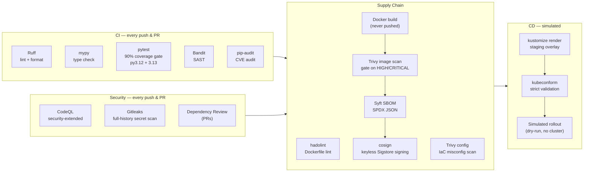

# 🛰️ Skyhook

[](https://github.com/danielneustadter/skyhook/actions/workflows/ci.yml)
[](https://github.com/danielneustadter/skyhook/actions/workflows/supply-chain.yml)
[](https://github.com/danielneustadter/skyhook/actions/workflows/codeql.yml)
[](https://github.com/danielneustadter/skyhook/actions/workflows/secrets-scan.yml)
[](https://securityscorecards.dev/viewer/?uri=github.com/danielneustadter/skyhook)

**A satellite mission-tasking API wrapped in a production-grade DevSecOps pipeline.**

The app is a small FastAPI service that schedules satellite missions and computes
orbital parameters (period, velocity, revolutions/day) from circular-orbit mechanics.
The app is deliberately simple — **the pipeline is the product**. Every push runs the
full gauntlet below; nothing is ever actually deployed (the final stage is a validated
dry-run by design).

## The pipeline



## What this repo demonstrates

| Practice | Implementation |
|---|---|
| **Static analysis** | Ruff (lint + format), mypy (typed codebase) |
| **Test gating** | pytest across Python 3.12/3.13 with a hard 90% coverage floor |
| **SAST** | Bandit + CodeQL with the `security-extended` query pack |
| **Secret hygiene** | Gitleaks over the *entire* git history on every push |
| **Dependency security** | pip-audit on pinned requirements, Dependency Review on PRs, weekly grouped Dependabot |
| **Container security** | Multi-stage build, non-root UID 10001, pinned base, hadolint, Trivy image scan gating on HIGH/CRITICAL |
| **IaC security** | Trivy config scan over Dockerfile + Kubernetes manifests |
| **Supply chain** | SPDX SBOM via Syft, keyless Sigstore/cosign signature, OpenSSF Scorecard |
| **Hardened deploy spec** | K8s manifests with seccomp, read-only rootfs, dropped capabilities, no SA token, probes, resource limits |
| **CD discipline** | kustomize base/overlay structure, kubeconform strict validation, simulated rollout gated on every scan passing |
| **Least-privilege CI** | Every workflow declares minimal `permissions:`; `id-token: write` only where Sigstore needs it |

## Running it locally

```bash
python -m venv .venv && source .venv/bin/activate
pip install -r requirements.txt -r requirements-dev.txt
uvicorn app.main:app --reload --port 8080
```

Then:

```bash
# Orbital profile for ISS altitude
curl http://localhost:8080/api/v1/orbits/408

# Create a mission
curl -X POST http://localhost:8080/api/v1/missions \
  -H 'Content-Type: application/json' \
  -d '{"name": "KESTREL-9", "altitude_km": 550, "inclination_deg": 53}'

# Activate it
curl -X PUT 'http://localhost:8080/api/v1/missions/1/status?status=active'
```

Interactive docs at `http://localhost:8080/docs`.

### The full local gauntlet

```bash
make check   # ruff + mypy + bandit + pytest w/ coverage gate
```

## API

| Method | Path | Description |
|---|---|---|
| `GET` | `/healthz` | Liveness probe |
| `GET` | `/readyz` | Readiness probe |
| `GET` | `/metrics` | Request counters (Prometheus-style) |
| `GET` | `/api/v1/orbits/{altitude_km}` | Orbital profile for an altitude |
| `POST` | `/api/v1/missions` | Create a mission |
| `GET` | `/api/v1/missions` | List missions |
| `GET` | `/api/v1/missions/{id}` | Get a mission |
| `PUT` | `/api/v1/missions/{id}/status` | Transition mission status |
| `DELETE` | `/api/v1/missions/{id}` | Delete a mission |

## Repo layout

```
app/                    FastAPI service (orbital math, in-memory store)
tests/                  pytest suite (90% coverage floor)
deploy/base/            Hardened K8s Deployment + Service
deploy/overlays/staging kustomize overlay validated by the CD stage
.github/workflows/      The six pipelines described above
Dockerfile              Multi-stage, non-root, healthchecked
```

## Non-goals

- **No real deployment.** The CD stage renders and validates manifests, then stops.
  There is no cluster, no cloud account, no registry push.
- **No real persistence.** Missions live in memory; the store is an interface seam.
- **No real flight dynamics.** Circular-orbit approximations only. Do not use this
  to fly your satellite.

## License

MIT — see [LICENSE](LICENSE).
